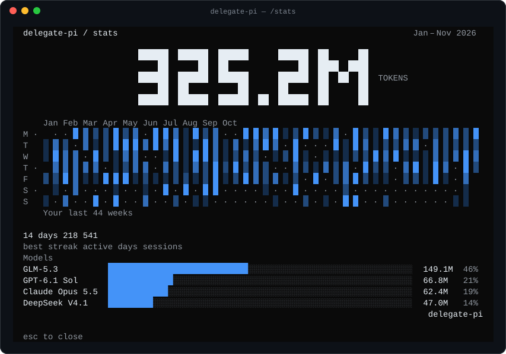
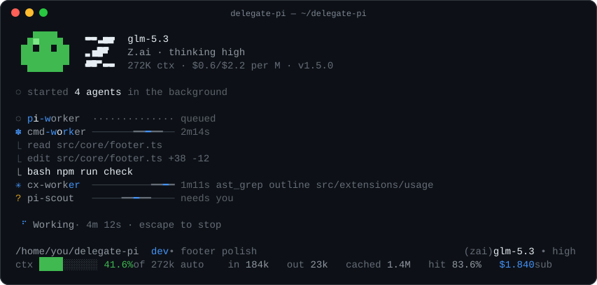
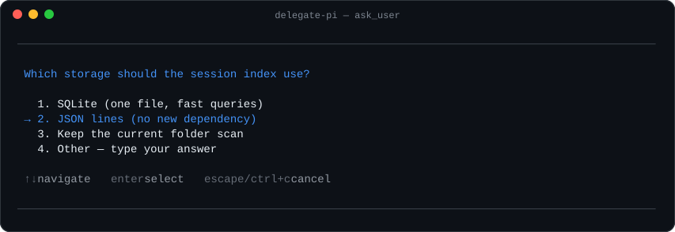

<p align="center">
  
</p>

<p align="center">
  <a href="LICENSE"></a>
  
  <a href="https://github.com/earendil-works/pi"></a>
</p>

<p align="center">A custom harness forked from <a href="https://github.com/earendil-works/pi"><b>Pi</b></a>.</p>

```bash
curl -fsSL https://raw.githubusercontent.com/farrukh2002/delegate-pi/main/install.sh | sh
```

## Highlights

<a name="delegate-your-work"></a><b>Delegate your work</b> <a href="#delegate-your-work"></a>

Hand tasks to any of these harnesses:

<table>
  <tr><th align="center" width="300">Agent</th><th align="center" width="300">Harness</th><th align="center" width="200">Writes</th><th align="center" width="300">CLI needed</th></tr>
  <tr><td align="center"><code>pi-scout</code></td><td align="center">pi</td><td align="center"></td><td align="center"></td></tr>
  <tr><td align="center"><code>pi-worker</code></td><td align="center">pi</td><td align="center"></td><td align="center"></td></tr>
  <tr><td align="center"><code>cc-scout</code></td><td align="center">Claude</td><td align="center"></td><td align="center"><code>claude</code></td></tr>
  <tr><td align="center"><code>cc-worker</code></td><td align="center">Claude</td><td align="center"></td><td align="center"><code>claude</code></td></tr>
  <tr><td align="center"><code>cx-worker</code></td><td align="center">Codex</td><td align="center"></td><td align="center"><code>codex</code></td></tr>
  <tr><td align="center"><code>cmd-worker</code></td><td align="center">Command Code</td><td align="center"></td><td align="center"><code>cmd</code></td></tr>
</table>

An outside CLI must be installed and logged in. Support for other CLIs will come with time.

Add your own agents as Markdown files in `~/.delegate-pi/agent/delegate/agents/` or `.delegate-pi/agents/`.

<a name="sandbox"></a><b>Sandbox</b> <a href="#sandbox"></a>

Every agent is restricted to its own sandbox and its file or folder scope.

<table>
  <tr><td align="center" width="300"><code>[]</code></td><td align="center" width="800">read-only</td></tr>
  <tr><td align="center"><code>["src/core"]</code></td><td align="center">writes under <code>src/core</code> only</td></tr>
  <tr><td align="center"><code>["."]</code></td><td align="center">the whole project</td></tr>
</table>

<a name="more"></a><b>And more</b> <a href="#more"></a>

- **Accept or undo.** Every write task ends with a diff. Keep it, or put the files back.
- **Live task band.** Running agents show above the prompt with their time and last tool call.
- **Questions with choices.** Agents and the model can ask you with numbered options or a typed answer.
- **`ast_grep` tool.** Structural code search, file outlines and callers.
- **`/stats` and `/usage`.** A year of token use, provider limits and cost per model.
- **Two-line footer.** Context, tokens, cache hits and price at a glance.
- **Model header and themes.** An animated pet, the provider logo, GitHub and opencode themes, an accent picker.
- **Did-you-mean.** A mistyped slash command gets a suggestion, not a prompt to the model.

<p align="center">
  
</p>

<p align="center">
  
</p>

## How it works

<p align="center">
  
</p>

1. **Ask.** You tell the model what you want.
2. **Delegate.** The model splits the work into tasks. Each task has an agent and a scope.
3. **Run in sandboxes.** The agents work at the same time. A write outside the scope fails.
4. **Review.** You get one report, and you accept or undo each agent's changes.

Running agents show above the prompt. <kbd>alt</kbd>+<kbd>d</kbd> focuses that list, <kbd>j</kbd>/<kbd>k</kbd> moves, <kbd>enter</kbd> expands a row. If an agent asks a question, you answer it in a dialog.

<p align="center">
  
</p>

## Everything else is pi

The [pi docs](packages/coding-agent/docs) apply as written. We use `~/.delegate-pi` -> `~/.pi` and `delegate-pi` -> `pi`. It installs next to upstream pi without a conflict.

## Install

```bash
curl -fsSL https://raw.githubusercontent.com/farrukh2002/delegate-pi/main/install.sh | sh
```

Linux (x64 or arm64) only. You need `bwrap` (bubblewrap). If you don't have Node.js 22.19 or newer, the installer gets its own copy.

At the end, the installer adds a short name. If `pi` is free, it asks to use `pi`. If upstream pi is installed, it uses `pi2`. Pick your own name with `--alias <name>`, or skip it with `--no-alias`:

```bash
curl -fsSL https://raw.githubusercontent.com/farrukh2002/delegate-pi/main/install.sh | sh -s -- --alias dp
```

Three release channels:

| Channel | What you get | Install |
| --- | --- | --- |
| `stable` | the latest release (default) | `… \| sh` |
| `rc` | the latest release candidate | `… \| sh -s -- --channel rc` |
| `dev` | a build of the latest `main` | `… \| sh -s -- --channel dev` |

The installer keeps your channel for later updates.

```bash
delegate-pi                                  # start, then /login
delegate-pi update                           # update
sh ~/.delegate-pi/app/install.sh --uninstall # uninstall (add --purge to delete settings too)
```

<details>
<summary>From source</summary>

```bash
git clone https://github.com/farrukh2002/delegate-pi.git && cd delegate-pi
npm install && npm run build
node scripts/delegate-pi-install.mjs
```

</details>

## Credits

- [pi](https://github.com/earendil-works/pi) by Mario Zechner and contributors. This is a fork of their work.
- [ast-grep](https://github.com/ast-grep/ast-grep) powers the `ast_grep` tool.
- The `/stats` screen and `opencode` theme are based on [OpenCode](https://github.com/anomalyco/opencode)'s design.

[MIT](LICENSE)
